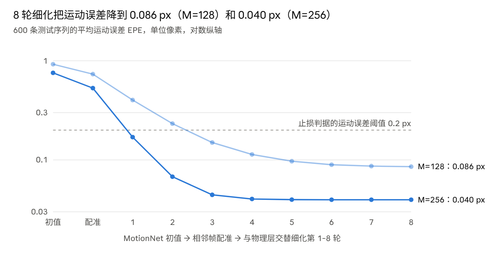

# 实验 E1 结果：运动补偿凑测量（2026-11-24）

## 结论

**事先写定的主判据在 128 和 256 两种测量数下都通过，止损条件没有触发。** 在粗 Transformer 之上，用估计的运动把 8 帧测量凑在一起做物理层重建（第 3 组），比 CNN 插件（第 2 组）的配对 PSNR 高 **13.1 dB**（M=128，95% 区间 12.9–13.3）和 **17.1 dB**（M=256，95% 区间 17.0–17.2）。判据要求的是至少 1 dB。

- 估计运动已接近真实运动：最终运动误差 0.086 px / 0.040 px，与用真实运动的上限组只差 0.6 dB（M=128），M=256 时没有差别。
- 提升来自多帧测量：物理层只用本帧测量时（诊断组），比粗重建低 2.3 dB（M=128）或仅高 0.5 dB（M=256）。
- 物理层之后再接 CNN（第 5 组）还能再多 4.1 dB / 3.5 dB，测试 PSNR 达到 38.9 / 44.2 dB。
- 主要保留：仿真里没有测量噪声，区间也没有覆盖粗 Transformer 和 MotionNet 的训练波动（见「局限」）。

## 实验设置

E1 问的是：Transformer 粗重建本来就会参考相邻帧，在它之上再用运动把 8 帧测量凑在一起，还能多出多少 dB。五组对照和一个诊断组用同一套观测、同一批测试身份：

| 组 | 代号 | 内容 |
| --- | --- | --- |
| 1 | coarse | 粗 Transformer |
| 2 | cnn | 粗 Transformer + CNN 插件（5 个种子） |
| 3 | phys_est | 粗 Transformer + 物理层，运动靠估计 |
| 4 | phys_true | 粗 Transformer + 物理层，用真实运动（上限） |
| 5 | phys_cnn | 粗 Transformer + 物理层 + CNN 插件（5 个种子） |
| 诊断 | phys_own | 物理层只用本帧自己的测量 |

- **数据**：弹跳 Moving MNIST，64×64 像素，每条 8 帧；每帧一套独立的 0/1 散斑；生成用双三次插值，物理层用双线性模型。训练 4,000 条，验证 600 条、测试 600 条为全新身份，排除了以前用过的 2,552 个。
- **测量数**：每帧 M=128 或 256，8 帧凑起来相当于 25% 或 50% 采样率。
- **粗网络**：粗 Transformer 在每帧散斑下重训 20 轮；MotionNet 重训版在验证集上配对误差 0.77 px，旧权重在每帧散斑下约 3 px，所以用重训版。
- **物理层**：从粗图出发，对多帧测量一致性 + 靠近粗图项 + TV 做带 [0,1] 约束的 FISTA；运动由 MotionNet 给初值，再与物理层交替细化 8 轮。μ 和 TV 权重只在 120 条验证序列上选。
- **运行**：恒源云单卡 RTX 3090，PyTorch 2.9.1+cu128；代码版本 1fcefaa，工作区无改动；判据于 2026-11-22 写入 `configs/e1_motion_pooling.json`，早于任何验证和测试结果。

## 主结果

物理层三组把测量残差从 0.04–0.11 压到 0.003 左右，PSNR 提高十几 dB；只用本帧测量的诊断组残差同样很低，图像却变差。600 条测试序列平均，CNN 两组为 5 个种子的平均。

**M=128（25% 采样）**

| 组 | PSNR (dB) | SSIM | 前景 PSNR (dB) | 相对测量残差 | 时间差分误差 |
| --- | --- | --- | --- | --- | --- |
| 1 coarse | 20.26 | 0.819 | 14.50 | 0.112 | 0.049 |
| 2 cnn | 21.80 | 0.878 | 15.63 | 0.046 | 0.040 |
| 3 phys_est | 34.87 | 0.929 | 28.41 | 0.0026 | 0.014 |
| 4 phys_true | 35.49 | 0.943 | 29.03 | 0.0024 | 0.012 |
| 5 phys_cnn | 38.93 | 0.992 | 32.42 | 0.0043 | 0.008 |
| 诊断 phys_own | 18.00 | 0.381 | 11.81 | 0.0024 | 0.072 |

**M=256（50% 采样）**

| 组 | PSNR (dB) | SSIM | 前景 PSNR (dB) | 相对测量残差 | 时间差分误差 |
| --- | --- | --- | --- | --- | --- |
| 1 coarse | 22.31 | 0.882 | 16.10 | 0.086 | 0.038 |
| 2 cnn | 23.59 | 0.913 | 17.20 | 0.038 | 0.032 |
| 3 phys_est | 40.70 | 0.983 | 34.39 | 0.0030 | 0.0069 |
| 4 phys_true | 40.57 | 0.982 | 34.25 | 0.0030 | 0.0070 |
| 5 phys_cnn | 44.18 | 0.999 | 37.84 | 0.0034 | 0.0038 |
| 诊断 phys_own | 22.80 | 0.628 | 16.49 | 0.0019 | 0.044 |

## 判据核对

主判据的四条要求在两种测量数下全部满足；止损条件要求第 3 组比粗重建的增益低于 0.5 dB，实际是 14.6 / 18.4 dB，远未触发。区间为 5,000 次配对 bootstrap，按测试身份重采样。

| 判据（第 3 组 vs 第 2 组） | 要求 | M=128 | M=256 |
| --- | --- | --- | --- |
| 配对 PSNR 增益 | ≥ 1 dB | +13.07 dB | +17.11 dB |
| 95% 区间下限 | > 0 | 12.86 dB | 16.99 dB |
| 平均 SSIM 变化 | ≥ 0 | +0.051 | +0.069 |
| 相对测量残差变化 | < 0 | −0.044 | −0.035 |
| 逐条胜率 | — | 99.2% | 100% |
| **结果** | | **通过** | **通过** |
| 止损：第 3 组 vs 第 1 组 | < 0.5 dB 且 EPE < 0.2 px | +14.61 dB，EPE 0.086 px | +18.39 dB，EPE 0.040 px |
| **止损是否触发** | | **否** | **否** |

## 分析

**运动越快，物理层相对 CNN 的提升越大。** 下表是配对 PSNR 增益（dB），按运动速度分档（像素/帧，每档 200 条）：

| 比较 | M | 1–2 | 2–4 | 4–6 | 全部 |
| --- | --- | --- | --- | --- | --- |
| 第 3 组 − 第 2 组 | 128 | 12.44 | 13.26 | 13.52 | 13.07 |
| 第 3 组 − 第 2 组 | 256 | 16.30 | 17.11 | 17.93 | 17.11 |
| 真实运动 − 估计运动（4 − 3） | 128 | 0.37 | 0.44 | 1.07 | 0.63 |
| 真实运动 − 估计运动（4 − 3） | 256 | −0.16 | −0.12 | −0.14 | −0.14 |
| 再接 CNN（5 − 3） | 128 | 4.08 | 4.08 | 4.02 | 4.06 |
| 再接 CNN（5 − 3） | 256 | 3.59 | 3.43 | 3.40 | 3.47 |
| 只用本帧 − 粗重建（诊断 − 1） | 128 | −3.26 | −2.16 | −1.37 | −2.26 |
| 只用本帧 − 粗重建（诊断 − 1） | 256 | −0.16 | 0.57 | 1.05 | 0.49 |

- **估计运动已经够用。** M=256 时用真实运动反而低 0.14 dB（区间 −0.16 至 −0.12）；M=128 时差 0.63 dB，主要集中在 4–6 像素/帧的快速档（1.07 dB）。
- **提升来自多帧测量。** 第 3 组比只用本帧的诊断组高 16.9 dB / 17.9 dB。诊断组的测量残差同样只有 0.002，SSIM 却掉到 0.38 / 0.63：单帧 128 或 256 个测量约束不住 4,096 个像素。
- **种子波动很小。** 第 3 组相对第 2 组的增益，5 个种子分别落在 13.05–13.11 dB 和 17.08–17.16 dB；第 5 组相对第 3 组为 4.01–4.17 dB 和 3.37–3.59 dB。
- **参数选在网格中间。** 两种测量数都选中 tv=1e-3（M=128：mu=0，验证 34.91 dB；M=256：mu=1e-3，验证 40.66 dB）。tv=3e-3 时两者都下降 2–3 dB，mu 在 0–1e-3 之间变化不超过 0.6 dB。

运动误差在前 4 步下降最快，第 5 轮之后基本不再变化；两种测量数的最终误差都远低于 0.2 px。横轴依次为 MotionNet 初值、相邻帧配准、与物理层交替细化第 1–8 轮。

## 耗时

**正式实验在 RTX 3090 上跑了 2 小时 10 分（00:42–02:52），一半的时间花在第 5 组上。** 推理时，物理层每条序列约 0.16–0.17 秒，是粗 Transformer 加 MotionNet（约 0.006 秒）的 25 倍左右。

| 阶段 | 耗时 |
| --- | --- |
| 单元检查 + 冒烟检查 | 约 1.5 分钟 |
| 生成数据 | 62 秒 |
| 重训粗 Transformer（20 轮） | 7.3 分钟 |
| 重训 MotionNet（20 轮） | 4.2 分钟 |
| 特征缓存 | 9 秒 |
| CNN 插件（第 2 组，5 个种子） | 34.5 分钟 |
| 物理层调参（12 组 × 2 种 M × 120 条） | 8.2 分钟 |
| 第 5 组：物理层特征（训练 22.2 + 验证 3.4 分钟）+ 5 个种子 | 68.6 分钟 |
| 最终评估（600 条 × 2 种 M） | 4.7 分钟 |

600 条测试序列的推理总时间：粗 Transformer + MotionNet 3.8 秒，CNN 插件每个种子约 0.2 秒，物理层 96.9 秒（M=128）和 103.9 秒（M=256）。物理层每条要做 8 轮运动细化，每轮 100 步 FISTA。

## 局限

**这是无噪声仿真下的结果，增益的绝对大小不能直接搬到真实 DMD 上。** 下面几点在对外引用结果前需要说明。

1. **没有测量噪声。** 桶测量是精确值，物理层可以把残差压到 0.003 左右。有噪声时，测量一致性项会连噪声一起拟合，增益预计会明显缩小，μ 和 TV 的最优值也会变。
2. **区间只覆盖部分波动。** bootstrap 重采样的是测试身份，CNN 两组先对 5 个种子取平均；粗 Transformer 和 MotionNet 各只训练了一份，它们的训练波动没有算进去。
3. **CNN 对照比较弱。** CNN 插件只比粗重建高 1.3–1.5 dB，测量残差仍有 0.04。「比 CNN 高 13–17 dB」主要说明学习方法几乎没有用上多帧测量，而不是物理层超过了一个强基线。
4. **场景简单。** MNIST 数字是黑底上的稀疏目标，运动是整体平移，TV 先验和平移运动模型都恰好合适。纹理更复杂、含形变或遮挡的场景还没有验证。
5. **推理代价高。** 物理层每条序列约 0.17 秒，是粗重建的 25 倍左右。

## 下一步与文件

**C 路线继续，最优先的是在测量噪声下复验。** 按实验纪律，任何代码、数据或参数改动都要用新的实验目录和新的测试身份块，不能再用本次测试结果挑参数。

- [ ] 噪声稳健性：在桶测量上加几档噪声，每档在验证集上重新选 μ 和 TV，看第 3 组相对第 2 组的增益如何下降
- [ ] 粗网络波动：粗 Transformer 和 MotionNet 至少再训练 2 个种子，把它们的波动纳入区间
- [ ] 更强的学习对照：加入显式用到多帧测量的展开式网络（交接文档里的 K≈5 次「物理层一步 + 小 CNN」交替）
- [ ] 提速：减少细化轮数——运动误差在第 5 轮后基本不变，可以测 4–5 轮是否够用

结果文件：

- 结果包：`gi_results_e1_motion_pooling_v1.zip`（24.7 MB，SHA256 `00da6d55de243808cfa2962300c3f3e5370ca0eec6ff5dc89bff2da1dcc4ec14`，见 `结果校验_20261124.json`；压缩包不进 git，只在本地保留）
- 核心结果：`artifacts/gi_results/evaluate/results.json`（`verdict`、`summary`、`paired`、`motion_epe_by_round_px`、`timing_seconds`）
- 逐条指标：`artifacts/gi_results/evaluate/rows.json`；调参：`artifacts/gi_results/tune/scores.json`
- 运行指南与判据：[`E1_RUN.md`](../../E1_RUN.md)、`configs/e1_motion_pooling.json`
