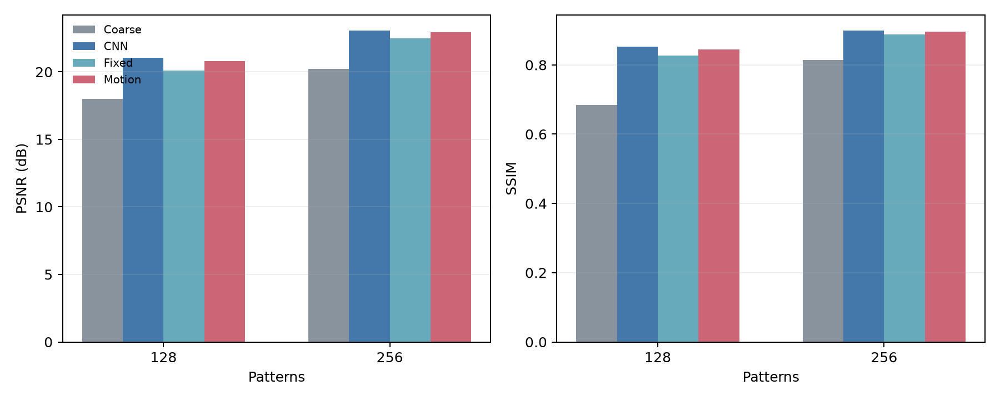
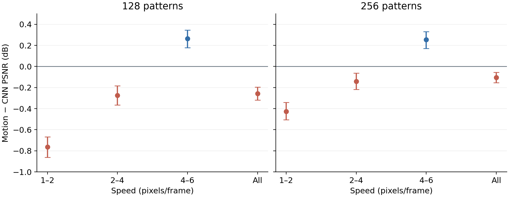
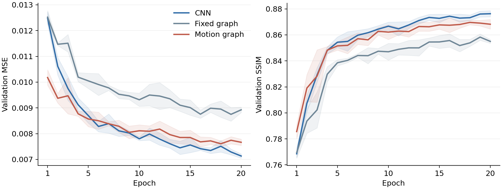

# 运动图细化扩大实验结果

本轮扩大实验已完整结束。运动图细化明显改善了粗重建，也优于固定图细化；与 CNN 相比，整体平均重建质量略低。此前小规模实验观察到的整体优势未在本轮保持，预设主判据未通过。高速运动组仍出现一定收益，应作为进一步分析的线索。

## 实验完成情况

2026 年 10 月 14 日 08:44:52 启动，10:07:02 完成结果上传，累计约 82 分 10 秒。实验主流程耗时 4,917.75 秒。全部 15 次训练均完成 20 轮，随后统一评估 600 个保留测试身份；结果包和校验包与完成回执的 SHA256 一致。

本轮使用单卡 RTX 3090，数据为 64×64、8 帧的 MNIST 单数字合成运动序列。训练身份 4,000 个，验证身份 600 个，最终测试身份 600 个；随机种子为 5 个，散斑数量为 128 和 256。粗重建器与运动估计器采用冻结权重，三个细化方案使用相同身份、批次顺序、损失和训练预算。

因此，本轮扩大的是样本数量、训练轮数和重复次数。图像分辨率、单数字任务及合成运动场景仍沿用原设置，结果不能直接推广到自然视频或真实光学测量。

## 整体重建质量

| 散斑数 | 方案 | PSNR（dB） | SSIM | MSE |
|---:|---|---:|---:|---:|
| 128 | 粗重建 | 18.016 | 0.6848 | 0.017232 |
| 128 | CNN 细化 | 21.055 | 0.8520 | 0.008837 |
| 128 | 固定图细化 | 20.114 | 0.8275 | 0.011068 |
| 128 | 运动图细化 | 20.797 | 0.8449 | 0.009466 |
| 256 | 粗重建 | 20.236 | 0.8144 | 0.010418 |
| 256 | CNN 细化 | 23.060 | 0.8992 | 0.005450 |
| 256 | 固定图细化 | 22.474 | 0.8874 | 0.006322 |
| 256 | 运动图细化 | 22.955 | 0.8967 | 0.005634 |

上述数值为 600 个测试身份及 5 个细化器种子的平均指标；粗重建器在不同种子间保持冻结。运动图相对粗重建的 PSNR 增益为 2.782 dB、2.719 dB，MSE 分别降低 45.07%、45.92%；相对固定图的 PSNR 增益为 0.683 dB、0.481 dB，MSE 分别降低 14.47%、10.89%。

图 1　整体质量

## 与 CNN 的比较

| 散斑数 | 运动图−CNN PSNR（dB） | 配对 95% 区间 | SSIM 变化 | MSE 增加 |
|---:|---:|---|---:|---:|
| 128 | -0.258 | [-0.320, -0.196] | -0.0071 | 7.12% |
| 256 | -0.105 | [-0.154, -0.054] | -0.0025 | 3.38% |

两个测量率下的 PSNR 差值及区间均为负，SSIM 也略低。预设判据要求运动图相对 CNN 的平均 PSNR 增益达到 0.5 dB、区间下限高于零且平均 SSIM 不下降，本轮两个测量率均未达到。

置信区间按 MNIST 身份进行配对 bootstrap：先平均同一身份在五个种子下的指标，再对身份重采样。它反映固定粗重建器和运动估计器条件下的身份变化，不涵盖所有重新训练骨干或更换数据集的情况。

本报告的 MSE 降低率使用“基线平均 MSE 减去方案平均 MSE，再除以基线平均 MSE”的定义。PSNR 使用 dB 差值，不将 dB 数值转换为提升百分比。

## 运动速度的影响

| 速度（像素/帧） | 128 散斑 PSNR 差值（dB） | 256 散斑 PSNR 差值（dB） |
|---|---:|---:|
| 1-2 | -0.764 | -0.426 |
| 2-4 | -0.273 | -0.143 |
| 4-6 | +0.264 | +0.253 |

这里的差值均为运动图减 CNN。高速组每个测量率包含 200 个测试身份：128 散斑的增益为 0.264 dB，95% 区间 [0.178, 0.345]，MSE 降低 5.53%；256 散斑的增益为 0.253 dB，区间 [0.172, 0.331]，MSE 降低 4.95%。SSIM 分别增加 0.0049、0.0036。

该结果提示运动图的收益与运动速度有关。高速组的优势未达到原定整体增益阈值，也不能替代整体主判据。速度分组已在实验协议中设置；将高速组进一步作为研究重点，仍需新的开发和确认实验。

图 2　速度分组

## 训练过程

| 轮数 | CNN 验证 MSE | 运动图验证 MSE | CNN 验证 SSIM | 运动图验证 SSIM |
|---:|---:|---:|---:|---:|
| 1 | 0.012479 | 0.010177 | 0.7685 | 0.7856 |
| 5 | 0.008699 | 0.008567 | 0.8543 | 0.8515 |
| 10 | 0.007800 | 0.008111 | 0.8667 | 0.8621 |
| 15 | 0.007561 | 0.007850 | 0.8727 | 0.8677 |
| 20 | 0.007132 | 0.007665 | 0.8763 | 0.8682 |

验证集曲线按五个种子平均，图中的阴影表示种子间一个标准差。运动图早期降低 MSE 较快，第 5 轮两者接近；第 10 轮以后，CNN 的平均验证 MSE 和 SSIM 更好。五个种子的 CNN 均在第 20 轮取得最佳验证选择分数，运动图的最佳轮次分布在第 15–20 轮。

这可以解释早期训练与充分训练时观察到的差异，但尚不能认定轮数是唯一原因。相比旧实验，本轮还增加了训练样本，并使用新的保留测试身份。当前证据支持“早期优势没有保持到整体最终结果”，需要在开发集上进一步区分训练预算、模型容量和运动估计等因素。

图 3　验证集曲线

## 推理时间

| 散斑数 | 方案 | 完整流程中位数（ms） | 比粗重建增加（ms） |
|---:|---|---:|---:|
| 128 | 粗重建 | 1.928 | 0.000 |
| 128 | CNN 细化 | 2.680 | 0.752 |
| 128 | 固定图细化 | 4.700 | 2.772 |
| 128 | 运动图细化 | 5.414 | 3.486 |
| 256 | 粗重建 | 2.114 | 0.000 |
| 256 | CNN 细化 | 2.894 | 0.781 |
| 256 | 固定图细化 | 5.093 | 2.979 |
| 256 | 运动图细化 | 5.863 | 3.750 |

计时以一个 8 帧、64×64 序列为单位，batch size 为 1，预热 15 次并测量 60 次。输入观测已在 GPU 上，计时不含采集、仿真和 CPU 到 GPU 的传输。运动图的完整时间包含运动估计；增加的时间按照“完整流程中位数减去粗重建流程中位数”计算。

运动图完整流程约为 CNN 的两倍，新增计算时间约为 CNN 的 4.6–4.8 倍。运动图和固定图均有 27,961 个可训练参数，CNN 有 74,745 个参数；当前实现中的参数量较小并未对应更低的实际延迟。这组比较采用相同训练预算，没有匹配参数量，结论适用于本轮三个具体实现。

## 后续讨论

本轮支持保留运动图相对固定图的改进结果，以及高速组的收益；整体重建质量和推理时间均未证明其优于当前 CNN。下一步应先解释速度分层与训练后期的差异，在开发和验证数据上检查运动估计误差、图连接与模型容量，再确定是否值得继续扩大实验。当前最终测试结果应固定保存，不能继续用它选择新参数；若形成新方案，需要另设确认测试。

## 已保存的材料

- [完整指标](artifacts/gi_results/final/results.json)
- [重建例图](artifacts/gi_results/final/example_reconstructions.png)
- [推理效率](artifacts/gi_results/efficiency.json)
- [核查记录](结果核查_20261014.json)
- 原始结果包、校验包和完成回执位于 `downloads/`，解压数据位于 `artifacts/gi_results/`。
