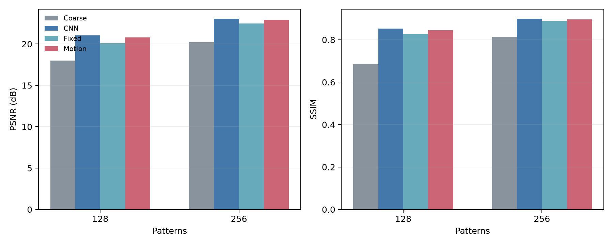
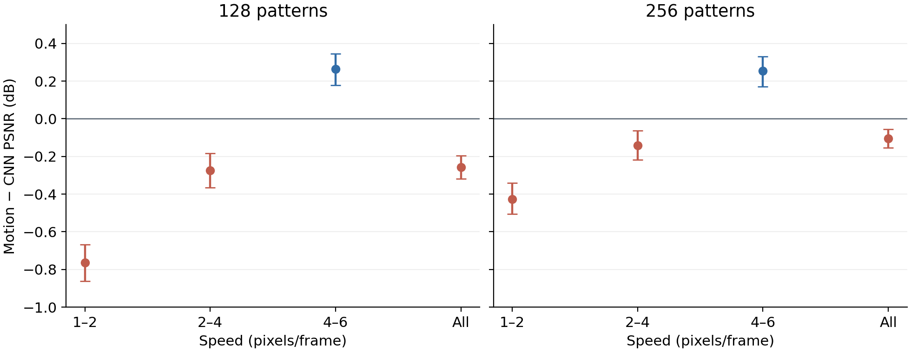
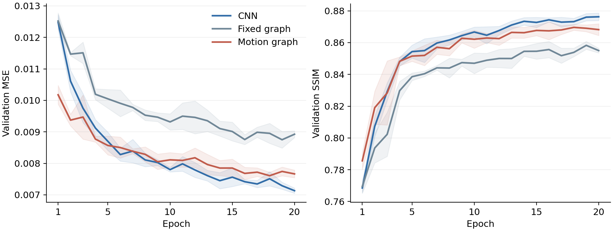

# 动态鬼成像与运动图细化项目交接书

本交接书整理截至 2026 年 11 月 13 日已归档的研究和工程进度，供后续实验、导师讨论与代码维护使用。资料基线为 GitHub 进度提交 `02add32`；最近一轮实验于 2026 年 10 月 14 日完成，运行代码为 `391b6c6`。文中该轮启动、完成时间均为北京时间。

## 一、交接摘要

项目目前已完成笔记本原型验证、工程集成、一次服务器 pilot，以及一次扩大样本和训练预算的确认实验。代码、固定数据划分、指标、图表和核查记录已经同步 GitHub，完整数据与权重保存在本地工程包及结果包中。

当前结论是：在现有 MNIST 合成任务中，运动图细化能改善粗重建，并优于固定图；扩大实验的整体质量略低于 CNN，推理时间也更长，因此“整体优于 CNN”的预设判据未通过。高速运动组仍有约 0.25–0.26 dB 的 PSNR 收益，值得继续分析其适用条件。

| 项目 | 交接状态 |
|---|---|
| 本地唯一项目根目录 | `C:\Users\lingye\Desktop\文献\文献及笔记` |
| GitHub 仓库 | <https://github.com/icy768/dynamic-gi-motion-graph>，默认分支 `main` |
| 当前研究主线 | 相同冻结 Transformer 粗重建下，比较 CNN、固定图、运动图三种细化方案 |
| 最近实验 | 4,000 个训练身份、600 个验证身份、600 个测试身份；5 个种子，每个细化器 20 轮 |
| 完成情况 | 15 次训练、共 300 个训练轮次全部完成，最终评估和结果核查已完成 |
| 实际耗时 | RTX 3090 上主流程 4,917.75 秒；启动至结果上传完成约 82 分 10 秒 |
| 最近确认的云端状态 | 2026-10-14 完成后自动关机；本次编写交接书未重新查询云端实例 |
| 接下来需要解决的问题 | 低速和中速为何退化、后期训练为何被 CNN 超过、运动估计与模型容量各有多大影响 |

接手时先阅读第四节的结果和第九节的后续工作，再按需恢复运行环境。当前阶段的主要工作是分析和设计下一轮受控实验。

## 二、研究目标与方向演变

### 2.1 最初的直接重建路线

早期问题是：图模型能否作为主要时序重建器，替代交替时空 Transformer。比较发生在完整重建模型之间，保留结果包括小型 Transformer、TGNN、真值运动图、估计运动图和联合训练等版本。

早期三次联合训练汇总中，图模型相对小型 Transformer 在 128、256、512、1024 散斑下的平均 PSNR 增益分别约为 0.60、0.46、0.44、0.59 dB，记录在 [早期重复实验汇总](transformer_vs_joint_repeat_summary.json)。这些重复共享预训练运动初始化，不能解释为整个系统的完整独立重复。

后续重新训练的受控版本也保留在仓库。以下数值仅对应 [graph_protocol_v2_trained/results.json](graph_protocol_v2_trained/results.json)，训练为 800 个身份、验证和测试各 120 个身份，重建训练 10 轮。

| 散斑数 | Transformer PSNR（dB） | 估计运动图 PSNR（dB） | 真值运动图 PSNR（dB） |
|---:|---:|---:|---:|
| 128 | 18.218 | 17.384 | 18.784 |
| 256 | 20.481 | 19.334 | 20.602 |

这组记录说明，运动信息正确时可能改善重建，但实际估计运动的表现与真值运动存在明显差距。历史目录还包含不同权重、数据块和诊断协议，引用时要写明具体版本。旧文档中的另一些受控比较数字不能直接替代上表，也不能与当前细化路线的指标合并。

### 2.2 转向共享粗重建后的细化比较

从 2026 年 9 月下旬起，主线调整为：冻结已有 Transformer 粗重建器，将粗视频与 GI 测量残差交给细化模块，比较 CNN、固定图和运动图带来的质量与时间变化。这样可以固定共同的粗重建来源，集中研究图聚合的增量作用。

因此，现在需要回答的是“在同一粗重建结果上，运动图在哪些条件下比其他细化方式更有效”，以及这种收益需要多少额外计算。早期直接替代 Transformer 的实验仍有研究价值，主要用于解释动机和运动信息的作用。

### 2.3 两篇参考工作的角色

按仓库已有研究笔记，DynGhost 提供动态 GI 任务与时序重建基线的研究背景；MadyGraph 提供运动引导图聚合、粗重建后增强的思路。当前实现是受其启发的 GI 适配原型。

当前观测为每帧分别取得 bucket 测量，MadyGraph 原研究涉及视频快照压缩成像，两者前向模型不同。现有小型 Transformer 也不能作为 DynGhost 原论文的完整复现。当前代码没有实现 MadyGraph 的全部动态游走、可学习邻居、跨尺度及全局节点机制。

历史说明见 [2026-09-29 交接文档](动态GI动态图研究_完整交接文档_2026-09-29.md)。其中旧的 D 盘依赖路径、早期环境版本和“运动图整体领先”的阶段性结论，已由本交接书及当前 README 更新。

## 三、实验方法与比较关系

### 3.1 观测与处理链路

数据为 MNIST 单数字生成的 8 帧、64×64 灰度序列，运动是带边界反弹的全局平移，速度分为 1–2、2–4、4–6 像素/帧。序列按固定身份和轨迹种子生成，不是自然视频或真实光学采集。

逐帧观测写为 `y_t = A x_t`，其中 `A = P / sqrt(H×W)`。处理过程如下：

```text
逐帧 bucket 测量 → DGI 序列 → 冻结 Transformer → 粗重建序列
                      └→ 冻结运动估计器 → 相邻帧位移

bucket 测量 + 粗重建 → 反投影测量残差
粗重建 + 测量残差 → CNN / 固定图 / 运动图细化 → 输出序列
运动图另使用估计的相邻帧位移。
```

测量残差为 `r = Aᵀ(y − A x_coarse) / M`，训练时按统一训练统计进行缩放。该残差依赖观测与粗重建，推理时不需要真值图像。真值图像在合成数据流程中用于生成观测、训练监督和评估。

### 3.2 三种细化方案

| 方案 | 时序处理 | 可训练参数量 | 主要比较用途 |
|---|---|---:|---|
| CNN | 3D 卷积进行时空特征处理 | 74,745 | 简单且有效的细化基线 |
| 固定图 | 相同坐标的跨帧聚合与空间邻域聚合 | 27,961 | 图结构对照 |
| 运动图 | 按估计位移对齐后进行跨帧聚合 | 27,961 | 检验运动引导的作用 |

细化器先将图像编码到 16×16、32 通道特征，再进行时序处理和解码，输出加回粗重建。图版本包含两层聚合。运动估计器为每对相邻帧输出二维全局位移，尚非稠密光流或局部运动场。

三个方案共用冻结粗重建、观测、训练/验证身份、批次顺序、损失和训练预算。CNN 的参数量更大，因此当前结果反映三个具体实现之间的表现，尚未控制参数量或计算量完全相同。固定图与运动图的参数量一致，对比更直接反映运动引导带来的变化。

### 3.3 训练与权重选择

- batch size 为 8，优化器为 AdamW，学习率 `5e-4`，weight decay 为 `1e-4`。
- 损失包含代码中的重建项、`0.15 × 时间差分误差`、`0.10 × (1 − SSIM)`。
- 按 `验证 MSE + 0.02 × (1 − 验证 SSIM)` 选择最佳权重。
- 每个细化器混合学习 128、256 两个散斑数量，在小批次间切换。
- 五个种子覆盖细化器训练；粗重建器、运动估计器和数据清单保持固定。
- 正式配置仅包含 `cnn,fixed,motion`。`oracle` 使用真值运动，仅供机制诊断，不是可部署方案，也未进入本轮主比较。

## 四、已完成实验及结论

### 4.1 服务器 pilot 与扩大实验

| 设置 | 2026-10-12 pilot | 2026-10-14 扩大实验 |
|---|---:|---:|
| 训练身份 | 800 | 4,000 |
| 验证身份 | 120 | 600 |
| 最终测试身份 | 120 | 600 |
| 每个细化器轮数 | 5 | 20 |
| 细化器随机种子 | 3 | 5 |
| 训练次数 | 9 | 15 |
| 散斑数量 | 128、256 | 128、256 |
| 图像和帧数 | 64×64、8 帧 | 64×64、8 帧 |
| 运动图相对 CNN 的预设判据 | 通过 | 未通过 |

pilot 中运动图相对 CNN 的 PSNR 增益为 0.827、0.815 dB，MSE 降低 16.57%、16.25%。结果位于 [pilot 最终指标](server_results/block3/gi_results/final/results.json)。扩大实验同时增加训练样本、训练轮数、种子数，并使用新的保留测试身份，不能将两轮差异只归因于其中一个因素。

### 4.2 扩大实验的整体质量

| 散斑数 | 方案 | PSNR（dB） | SSIM | MSE |
|---:|---|---:|---:|---:|
| 128 | 粗重建 | 18.016 | 0.6848 | 0.017232 |
| 128 | CNN | 21.055 | 0.8520 | 0.008837 |
| 128 | 固定图 | 20.114 | 0.8275 | 0.011068 |
| 128 | 运动图 | 20.797 | 0.8449 | 0.009466 |
| 256 | 粗重建 | 20.236 | 0.8144 | 0.010418 |
| 256 | CNN | 23.060 | 0.8992 | 0.005450 |
| 256 | 固定图 | 22.474 | 0.8874 | 0.006322 |
| 256 | 运动图 | 22.955 | 0.8967 | 0.005634 |

表中为 600 个测试身份、五个细化器种子的平均指标。运动图相对粗重建的 MSE 分别降低 45.07%、45.92%，相对固定图分别降低 14.47%、10.89%。



图 1　整体质量

### 4.3 主判据与 CNN 对比

预设要求两个测量率下，运动图相对 CNN 的平均 PSNR 增益均达到 0.5 dB、配对 95% 区间下限高于零，且平均 SSIM 不下降。扩大实验结果如下。

| 散斑数 | PSNR 差值（运动图−CNN） | 配对 95% 区间 | SSIM 差值 | MSE 增加 |
|---:|---:|---|---:|---:|
| 128 | −0.258 dB | [−0.320, −0.196] | −0.0071 | 7.12% |
| 256 | −0.105 dB | [−0.154, −0.054] | −0.0025 | 3.38% |

两个测量率均未达到主判据，最终结果中的 `accepted` 为 `false`。工程流程和文件核查已通过，这个字段表示科学判据未达到。

### 4.4 速度分层与训练过程

| 速度（像素/帧） | 128 散斑 PSNR 差值（dB） | 256 散斑 PSNR 差值（dB） |
|---|---:|---:|
| 1–2 | −0.764 | −0.426 |
| 2–4 | −0.273 | −0.143 |
| 4–6 | +0.264 | +0.253 |

差值均为运动图减 CNN。高速组每个测量率有 200 个身份，128、256 散斑的 95% 区间分别为 [0.178, 0.345]、[0.172, 0.331]，MSE 分别降低 5.53%、4.95%。高速组的收益支持继续研究适用场景，其幅度尚未达到原定 0.5 dB 阈值。



图 2　速度分组

验证曲线显示，运动图早期降低 MSE 较快，第 5 轮两者接近；随后 CNN 继续改善。第 20 轮，CNN 与运动图的平均验证 MSE 分别约为 0.007132、0.007665。五个种子的 CNN 都在第 20 轮获得最佳验证选择分数，运动图的最佳轮次为第 15–20 轮。早期收敛速度可能解释部分阶段性差异，尚不能据此确定唯一原因。



图 3　验证集曲线

### 4.5 推理时间与运行时长

| 散斑数 | 方案 | 完整流程中位数（ms） | 比粗重建增加（ms） |
|---:|---|---:|---:|
| 128 | 粗重建 | 1.928 | 0.000 |
| 128 | CNN | 2.680 | 0.752 |
| 128 | 固定图 | 4.700 | 2.772 |
| 128 | 运动图 | 5.414 | 3.486 |
| 256 | 粗重建 | 2.114 | 0.000 |
| 256 | CNN | 2.894 | 0.781 |
| 256 | 固定图 | 5.093 | 2.979 |
| 256 | 运动图 | 5.863 | 3.750 |

单位为一个 8 帧序列，batch size 为 1，在 RTX 3090 上预热 15 次、测量 60 次。输入 bucket 已在 GPU 上，计时不含光学采集、仿真、磁盘读取和 CPU 到 GPU 的传输。运动图完整流程包含运动估计。

新增时间使用“该方案完整流程中位数减去粗重建完整流程中位数”，纯细化器耗时另见 `efficiency.json`。运动图完整时间约为 CNN 的两倍，新增时间约为 CNN 的 4.6–4.8 倍。参数更少未带来更低的当前实现延迟。

主流程耗时约 81 分 58 秒，至上传完成约 82 分 10 秒。共享训练和验证特征分别预计算约 48.58 秒、6.07 秒，后续五个种子共用。冻结骨干、低分辨率、小型细化器与共享缓存共同决定了本轮运行规模，不能按大模型从头训练的耗时理解。依赖安装和工程包上传不包含在该 82 分钟内。

## 五、工程结构与代码入口

```text
项目根目录/
├── README.md
├── 项目交接书_2026-11-13.md
├── run_server_experiment.py
├── project_paths.py
├── gi_experiment.py
├── experiment_protocol.py
├── train_madygraph_gi_plugin.py
├── evaluate_madygraph_gi_final.py
├── benchmark_madygraph_gi_plugin_efficiency.py
├── prepare_experiment_cache.py
├── package_gi_project.py
├── configs/
│   ├── mnist_block3.json
│   ├── mnist_scaleup.json
│   └── mnist_scaleup_splits.json
├── scripts/
│   ├── setup_hengyuan.sh
│   └── run_hengyuan_scaleup.sh
├── data/MNIST/raw/
├── checkpoints/
├── dist/
└── server_results/
    ├── block3/gi_results/
    └── scaleup_v1/
        ├── downloads/
        ├── artifacts/gi_results/
        ├── 扩大实验结果_20261014.md
        └── 结果核查_20261014.json
```

| 入口 | 职责 |
|---|---|
| `run_server_experiment.py` | 统一调度检查、短程验证、缓存、训练、最终评估和计时 |
| `project_paths.py` | 从脚本位置确定唯一根目录，记录源码版本与冻结权重哈希 |
| `gi_experiment.py` | 配置、资源校验、冻结模型加载和原子写入 |
| `experiment_protocol.py` | 数据身份、轨迹种子、排除清单及协议签名 |
| `train_madygraph_gi_plugin.py` | 观测、DGI、测量残差、三个细化器及逐轮恢复 |
| `prepare_experiment_cache.py` | 生成和加载共享训练/验证特征缓存 |
| `evaluate_madygraph_gi_final.py` | 核查完整训练后执行保留测试、配对统计和结果图 |
| `benchmark_madygraph_gi_plugin_efficiency.py` | 完整流程和各模块计时、显存口径记录 |
| `package_gi_project.py` | 工程包、结果包及校验 ZIP |
| `prepare_scaleup_data.py` | 原扩大实验身份清单的准备过程，已完成的清单保持固定 |
| `scripts/setup_hengyuan.sh` | 安装锁定的服务器依赖并检查 CUDA 和资源 |
| `scripts/run_hengyuan_scaleup.sh` | 使用锁防止重复启动，运行全流程并按参数上传、关机 |
| `verify_scaleup_preparation.py` | 已有工程准备检查入口，不属于最终科学结果 |

统一入口的 `--stage` 支持 `check`、`smoke`、`cache`、`train`、`evaluate`、`benchmark`、`all`。**`--config` 默认仍是 pilot 的 `configs/mnist_block3.json`。扩大实验的每条手动命令都要显式指定 `--config configs/mnist_scaleup.json`。**

正式启动脚本还固定了扩大实验的目录和上传对象名。下一轮若更换研究配置，应修改或新建启动封装，并检查这些位置；Python 统一入口支持显式传入新配置。

## 六、数据、权重与结果资产

### 6.1 数据和固定划分

MNIST 四个未压缩原始文件位于 `data/MNIST/raw/`，包括 60,000 张官方训练图像、10,000 张官方测试图像及标签，合计约 52.4 MiB。本轮实际使用其中 4,000 个官方训练身份作为训练，600 个官方测试身份作为验证，另 600 个官方测试身份作为最终测试。

固定身份、来源分区和轨迹种子保存在 [数据划分清单](configs/mnist_scaleup_splits.json)。验证与最终测试身份互斥，并排除了根据已保存记录和旧采样器重建的 1,352 个历史曝光测试身份。该排除范围不涵盖无法追溯的旧实验。

同一个数字索引在官方训练、测试分区中不表示同一身份，核对时需要连同 `source` 字段。五个种子重复使用同一批测试身份，因此本轮独立测试身份数为 600。

### 6.2 冻结模型与训练结果

| 资产 | 位置 | 大小或数量 |
|---|---|---:|
| 冻结粗重建器 | `checkpoints/best_transformer.pt` | 268,384 字节 |
| 冻结运动估计器 | `checkpoints/best_spatial_motion_net.pt` | 2,530,989 字节 |
| 最佳细化器权重 | `server_results/scaleup_v1/artifacts/gi_results/seed*/best_*_refiner.pt` | 15 份 |
| 每个方案最后一轮恢复状态 | 同目录 `last_*_training.pt` | 15 份 |
| 共享训练/验证特征 | 原服务器 `runs/mnist_scaleup_v1/feature_cache/` | 约 3.5 GiB |

完整工程包包含原始 MNIST、两个冻结模型和必要代码，解压内容约 55.6 MiB。结果包不含大体积缓存张量，只保留缓存元数据；恢复时可以按原条件重建缓存。

### 6.3 本地与 GitHub 的保存范围

GitHub 已归档代码、配置、研究笔记、CSV、JSON、结果图、数据划分清单及结果核查记录。数据集、模型权重、ZIP、运行日志和临时文件按 `.gitignore` 留在本地。**仅克隆 GitHub 不能获得完整可运行资源。**参考论文 PDF 也按现有忽略规则保存在本地，位置见历史交接文档中的原文链接，移交研究资料时应一并复制。

本地关键压缩包如下。云端个人数据曾上传对应文件，本次交接未重新核验其云端留存情况；恢复首先以本地副本为依据。

| 文件 | 本地位置 | 字节数 |
|---|---|---:|
| 完整运行工程 | `dist/gi_project_scaleup_server.zip` | 14,249,635 |
| 工程校验包 | `dist/gi_project_scaleup_server_checksums.zip` | 554 |
| 扩大实验结果 | `server_results/scaleup_v1/downloads/gi_results_mnist_scaleup_v1.zip` | 14,313,031 |
| 结果校验包 | 同目录 `gi_results_mnist_scaleup_v1_checksums.zip` | 607 |
| 当轮完成回执 | 同目录 `gi_scaleup_completion_receipt.zip` | 523 |

工程 ZIP 的 SHA256：

```text
cfa6a78095e288c6cbb89c01e0189c7393458ae84f5d50fc63bfde93ec2efb22
```

结果 ZIP 的 SHA256：

```text
a0ec6ad8d5b05e73118254153462bb889684c6e92f420306155799f3fdba6712
```

更多资源哈希见 [asset_manifest.json](asset_manifest.json)，最终权重签名与完成回执见 [核查记录](server_results/scaleup_v1/结果核查_20261014.json)。

## 七、运行环境与复现流程

### 7.1 已验证的环境

| 项目 | 2026-10-14 运行记录 |
|---|---|
| 平台 | 恒源云，Ubuntu 22.04 |
| GPU | NVIDIA RTX 3090，24 GB |
| Python | 3.11.14 |
| PyTorch / torchvision | 2.9.1+cu128 / 0.24.1+cu128 |
| CUDA 运行时 | 12.8 |
| NumPy | 2.2.6 |
| matplotlib | 3.11.2 |
| pytorch-msssim | 1.0.0 |
| Pillow | 12.3.0 |
| 会话与工具 | bash、tmux、flock、恒源云 OSS 客户端 |

版本以原实验记录为依据，依赖安装入口为 `scripts/setup_hengyuan.sh` 和 `requirements-hengyuan.txt`。服务器数据根目录为 `/hy-tmp/gi_project`；GPU 缓存与依赖需要额外空间，原实例使用 50 GB 数据盘。

### 7.2 阅读和核对现有结果

分析已有 JSON、CSV 和图片不需要重新申请 GPU。主结果位于：

```text
server_results/scaleup_v1/artifacts/gi_results/final/results.json
server_results/scaleup_v1/artifacts/gi_results/efficiency.json
server_results/scaleup_v1/artifacts/gi_results/seed0...seed4/
```

在本地 PowerShell 进入项目根目录后，可核对结果 ZIP：

```powershell
Set-Location 'C:\Users\lingye\Desktop\文献\文献及笔记'
Get-FileHash '.\server_results\scaleup_v1\downloads\gi_results_mnist_scaleup_v1.zip' -Algorithm SHA256
```

该值应与第六节一致。解压结果包后，顶层目录名为 `gi_results/`；不要误认为它已经位于程序默认读取的 `runs/mnist_scaleup_v1/`。

### 7.3 恢复历史工程环境

需要恢复 10 月 14 日的环境时，优先使用已经封存的 `gi_project_scaleup_server.zip`。GitHub 的 `02add32` 增加了结果和说明，而原运行包固定了 `391b6c6` 的代码与版本元数据；恢复状态的指纹检查可能因版本元数据变化而拒绝混用。

以下为原协议的复现步骤，供确认版本和结果使用。它不构成下一轮新方法实验的配置。

在恒源云 JupyterLab 终端或 SSH 终端中，先确认没有同名活动任务，目标工程目录未占用；已有目录需先妥善保存。然后执行：

```bash
cd /hy-tmp
oss login
oss cp oss://gi_project_scaleup_server.zip . &&
echo 'cfa6a78095e288c6cbb89c01e0189c7393458ae84f5d50fc63bfde93ec2efb22  gi_project_scaleup_server.zip' | sha256sum -c - &&
test ! -e /hy-tmp/gi_project &&
python -m zipfile -e gi_project_scaleup_server.zip . &&
cd /hy-tmp/gi_project &&
bash scripts/setup_hengyuan.sh
```

也可以直接传输本地工程 ZIP 到服务器，再从校验一步继续。工程包已含本轮必需数据，无须在服务器重新下载 MNIST。校验或目录检查失败时先处理原因，避免继续覆盖。

### 7.4 分阶段入口与完整执行

资源检查和短程检查入口如下，短程检查使用训练/验证数据，不读取保留最终测试：

```bash
python run_server_experiment.py --config configs/mnist_scaleup.json --stage check --require-cuda
python run_server_experiment.py --config configs/mnist_scaleup.json --stage smoke --require-cuda
```

需要完整复现原协议时，在 tmux 中启动：

```bash
tmux new -s gi_scaleup
bash scripts/run_hengyuan_scaleup.sh --upload --shutdown-after-upload
```

关闭网页、SSH、Codex 或本地笔记本不会终止 tmux 内的服务器任务。按 `Ctrl+B` 后按 `D` 可离开会话；重新登录后用 `tmux attach -t gi_scaleup` 返回。

标准启动脚本执行检查、共享缓存、15 次训练、最终评估、效率测量和打包，再上传结果 ZIP 与校验 ZIP，两次上传均成功后执行关机。失败时保留实例和已保存状态，需及时查看日志并处理。

10 月 14 日实际运行还使用了额外的临时控制脚本生成第三个“完成回执 ZIP”、移除当次临时 SSH 公钥后关机。该控制脚本不属于已提交的正式源码，现有仓库启动脚本只保证上述两个结果文件的上传。后续若需要同样的回执，应将这部分运维流程正式化并重新检查；历史回执已保存在本地及核查记录中。

### 7.5 中断恢复与结果取回

每个方案完成一轮后，原子保存模型、优化器、最佳权重、训练历史、批次生成器与随机数状态。保留原运行目录、代码、配置、资源、GPU 和依赖环境后，重用同一启动命令可跳过已完成种子并从最近完整轮次恢复；中断当轮重新执行。

仅有结果 ZIP 时，需要先恢复原工程包，再把结果中的 `gi_results/` 内容放回配置指定的 `runs/mnist_scaleup_v1/`，保持 `seed*/`、`final/` 等内部结构。缓存张量未打包，可按原环境重建。不要通过关闭签名检查强行恢复到不同协议。

服务器结果下载后，要同时核对校验包、最终 JSON、训练记录和权重签名。关机状态或 GPU 利用率归零都不足以单独判定实验完成。旧实例临时盘和旧 SSH 端口不作为长期恢复依据。

本地 OSS 工具已知位置为 `D:\download\oss.exe`。登录应使用工具自身流程，凭据由工具管理，交接书和仓库不保存密码、令牌或私钥。

## 八、结果核查与实验约束

### 8.1 已有核查证据

[结果核查记录](server_results/scaleup_v1/结果核查_20261014.json)已经记录以下检查通过：

- 原始三个 ZIP 的 CRC 检查，结果及校验 ZIP 与完成回执的 SHA256 一致。
- 运行配置和代码来源与封存版本匹配。
- 15 次训练均有完整 20 轮记录及最终权重签名。
- 验证和最终测试身份互斥，已知历史曝光身份按清单排除。
- 同一随机种子内，三个细化器的小批次顺序一致。
- 最终评估使用的权重与归档权重一致，日志中记录一次 600 身份的正式最终评估。
- 效率测量引用的权重与对应 seed0 最终权重一致。

这些检查与统计结果已在先前实验核查时完成，本交接书引用其证据。

### 8.2 指标解释

MSE 百分比采用：

```text
MSE 降低率 = 100 × (基线平均 MSE − 方案平均 MSE) / 基线平均 MSE
```

负值表示 MSE 增加，例如 128 散斑下 `motion_vs_cnn` 的 −7.12% 降低率，在正文中写作“MSE 增加 7.12%”。PSNR 使用 dB 差值，SSIM 使用直接差值。

配对 bootstrap 先对同一身份的五个细化器种子指标取平均，再按身份重采样，重复 5,000 次。区间条件于共同的冻结骨干与运动估计器，不涵盖完整系统重新训练、换数据集或真实光学域的全部不确定性。种子波动单独输出。

### 8.3 后续实验需要保持的约束

1. 已使用的本轮最终测试结果固定保存，不用它反复选择图结构、轮数或超参数。
2. 原 `configs/mnist_scaleup_splits.json` 及其 SHA256 保持不变；原 `prepare_scaleup_data.py` 是本轮清单的准备入口，不能直接当成下一轮确认集生成器。
3. 新方法应使用新实验标识、独立目录和配置，先在开发/验证数据上决定方案，再设置新的确认测试。
4. 新清单需要审计已见过的身份，包括本轮已读的最终测试身份。已有历史排除表不会自动覆盖后来发生的全部曝光。
5. 缓存和恢复状态包含资源、源码和运行环境约束；更换硬件或软件后按新运行处理，不能静默混入旧状态。
6. 后续提出更改主判据时，应作为新实验协议明确记录；本轮未达标的结论继续保留。

## 九、当前问题与后续工作

目前已经有足够证据说明整体提升没有保持。继续工作应围绕原因和适用条件组织，先利用现有资料，再决定下一轮训练的范围。

| 顺序 | 工作 | 需要形成的材料 | 判断依据 |
|---:|---|---|---|
| 1 | 汇总低、中、高速的误差、学习曲线和代表样本 | 一份问题定位表，列出观察与解释假设 | 同时使用 PSNR、SSIM、前景质量、时间误差及测量一致性，避免只选有利例图 |
| 2 | 在开发/验证数据上评估运动估计误差 | 按速度、反弹位置和图像质量分层的位移误差 | 检验图退化是否与运动误差相关，区分估计问题与聚合问题 |
| 3 | 设计同一结构下估计运动、零运动及真值运动对照 | 受控消融协议，明确真值运动仅为诊断上限 | 同预算、同数据，避免把训练或结构差异归因于运动 |
| 4 | 控制模型容量和训练预算 | 参数量接近的 CNN/图对照与收敛记录 | 当前 CNN 参数更多，且最佳验证分数仍在末轮，现有实验不能排除容量或优化因素 |
| 5 | 根据诊断选择小范围修改 | 少量预先说明的方案及开发集结果 | 可考虑运动置信度、低速门控或图连接方式；这些均为待验证建议，尚未实现 |
| 6 | 锁定新方案后进行独立确认 | 新配置、新身份清单、预算、主判据、计时与打包检查 | 新保留测试只在方案固定后执行，保留不利结果 |

多目标、遮挡、局部运动、自然视频和真实 bucket 观测属于后续范围，当前尚未形成相应的确认实验。扩展场景前，需要先说明单数字合成域中的机制和计算代价。

模型当前只估计全局平移，图连接也较简单；固定图与运动图的差异相对明确，但不能据此直接推断完整动态图模型在复杂场景中的表现。小规模实验的正结果与扩大实验的负结果都应保留在汇报中。

## 十、GitHub 版本与归档状态

仓库地址为 <https://github.com/icy768/dynamic-gi-motion-graph>，项目既定为私有仓库，默认分支 `main`。

| 版本或提交 | 含义 |
|---|---|
| `v0.1.0-notebook-baseline` | 最初笔记本研究快照 |
| `v0.1.1-server-ready` | 单目录集成和服务器运行准备 |
| `v0.2.0-scaleup-ready` | 扩大实验配置、固定划分、缓存与恢复代码 |
| `v0.2.1-scaleup-ready` / `391b6c611067a5f9e5e2bbbf408e99289cbf427a` | 10 月 14 日实际运行所依据的工程代码及校验 ZIP 支持 |
| `02add32d5889975c9125d62c3d9f57ab36421f98` | 2026-11-13 已同步的扩大实验结果和研究进度，包含 54 个文件的归档与说明更新 |

`02add32` 增加结果、图表与说明，没有改变本轮使用的训练代码、配置或保留测试划分。本交接书以该提交为资料基线；交接书本身在后续文档提交中归档。

十个基础依赖模块最初由旧工程补入，来源提交为 `130c64e3e35482dbcdc1516f29afe1c25d0d9656`，导入记录见 [source_provenance.json](source_provenance.json)。当前运行已按项目根目录定位资源，不依赖原 D 盘源码目录。

原始压缩包和权重需要连同项目本地副本交接。后续收到仅有 Git 克隆的环境，应先补齐第六节资源，再运行资源检查。

## 十一、接手顺序与验收清单

建议按以下顺序接手：

1. 阅读本交接书、当前 README 和扩大实验结果分析，确认研究比较对象及主结论。
2. 查看 `02add32` 的结果归档与 `391b6c6` 的运行版本记录，确认所用代码、协议和权重来源。
3. 找到本地完整工程 ZIP、结果 ZIP 和两个冻结权重，核对文件名、大小与校验值。
4. 先利用已归档的指标、训练历史和图表完成问题定位；原始结果保留不改。
5. 确需恢复模型时使用封存工程包，按原环境检查；新研究方案另建协议。
6. 与导师明确下一轮要回答的具体问题、预算和确认标准，再准备 GPU 任务。

交接材料验收点：

- [ ] 能定位唯一项目根目录和 GitHub 仓库。
- [ ] 能说明直接模型比较与共享粗重建后的细化比较分别对应哪些结果。
- [ ] 能找到 15 次完整训练、600 个最终测试身份及原始最终 JSON。
- [ ] 能说明整体判据未通过，并找到高速组收益的证据和适用范围。
- [ ] 能从校验记录追溯数据、冻结权重和最终细化器权重。
- [ ] 已取得 Git 不包含的数据、权重和压缩包副本。
- [ ] 知道手动命令默认读取 pilot 配置，需要显式传入扩大配置。
- [ ] 新实验不会覆盖本轮目录或继续用本轮最终测试选择参数。
- [ ] 新部署的打包、上传和关机流程与实际脚本能力一致。

## 十二、关键材料索引

| 材料 | 用途 |
|---|---|
| [README](README.md) | 当前项目入口和结论摘要 |
| [扩大实验完整分析](server_results/scaleup_v1/扩大实验结果_20261014.md) | 导师讨论和结果解释 |
| [扩大实验运行记录](server_results/scaleup_v1/运行记录_20261014.md) | 历史运行与保存过程 |
| [扩大实验核查记录](server_results/scaleup_v1/结果核查_20261014.json) | 校验、签名、训练预算和回执证据 |
| [扩大实验最终指标](server_results/scaleup_v1/artifacts/gi_results/final/results.json) | 所有质量指标、配对区间与速度分层 |
| [扩大实验效率记录](server_results/scaleup_v1/artifacts/gi_results/efficiency.json) | 计时定义、完整流程及模块时间 |
| [重建例图](server_results/scaleup_v1/artifacts/gi_results/final/example_reconstructions.png) | 固定示例的直观对比 |
| [pilot 最终结果](server_results/block3/gi_results/final/results.json) | 小规模服务器验证 |
| [原模型多次训练汇总](transformer_vs_joint_repeat_summary.json) | 早期直接比较的阶段性结果 |
| [受控直接重建结果](graph_protocol_v2_trained/results.json) | 旧路线的重新训练版本 |
| [扩大实验配置](configs/mnist_scaleup.json) | 原预算和判据 |
| [固定身份与轨迹清单](configs/mnist_scaleup_splits.json) | 数据来源、划分和曝光排除 |
| [扩大实验运行说明](SCALEUP_RUN.md) | 已执行协议及操作流程 |
| [资产清单](asset_manifest.json) | 数据和冻结模型的文件信息与哈希 |
| [历史交接文档](动态GI动态图研究_完整交接文档_2026-09-29.md) | 更早的动机、消融和研究过程 |

本交接书以仓库中的实验产物为依据。后续新增结论时，应同时保存对应配置、数据划分、权重签名和原始指标，并更新当前 README 与交接记录。
